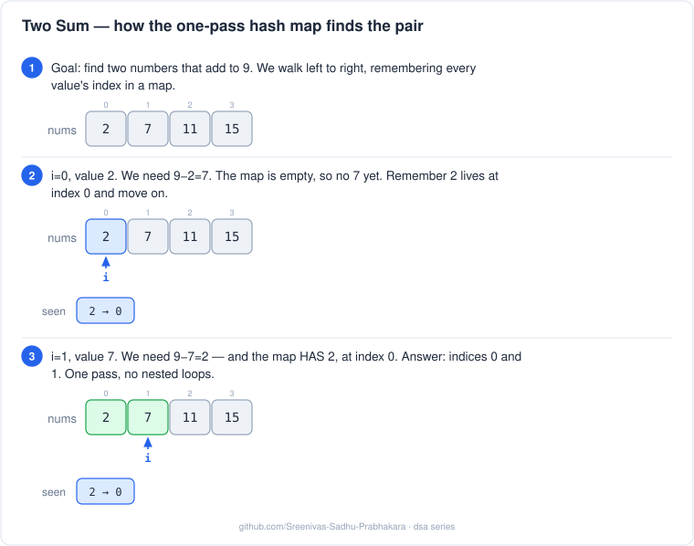

# Two Sum

> Striver SDE Sheet 019 · Day 4 Arrays — one pass with a value→index map; each element asks for the complement it needs. Go, stdlib only, tested.

## Problem

Given an array and a target, return the indices of two distinct elements that sum to the target (nil if none). The classic warm-up whose point is replacing the O(n²) pair scan with a hash lookup.

## Approach

Walk the array once, building a map from value to index. Before inserting the current element, check whether its complement (`target − v`) is already in the map — if so, the pair is found, and the map-before-insert order guarantees the two indices are distinct even when both elements have the same value (as in `[3,3]`, target 6). One pass handles duplicates, negatives and "no answer" uniformly.

**Complexity:** O(n) time, O(n) space.

## Visual walkthrough

Read the picture top to bottom — each numbered frame is one moment of the algorithm
running on this repo's test example.

## Run

    go test ./...   # verify
    go run .        # demo

---

One of 191 repos solving Striver's SDE Sheet in Go — stdlib only, one problem per repo, every solution tested. Browse the set: [`dsa-*` repos](https://github.com/Sreenivas-Sadhu-Prabhakara?tab=repositories&q=dsa-&type=source).
